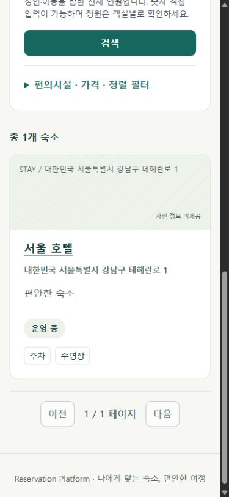

# 검색·Booking 복귀와 Scroll/Focus 계약 (#243)

2026-10-24(Asia/Tokyo), 최신 `develop`의 `46507c7`에서
`feature/#243-search-booking-return-context`를 생성했다. 선행 #241/#242가 포함된 기준이다.
Backend/API/예약 규칙·토큰 저장 방식·의존성·환경변수·실행/CI 설정은 변경하지 않았다.

## 디자인 참조와 범위

구현 전 [승인 기준](../ui/approved-design.md), 저장소의 `premium-travel/index.html` 및
`review.html`을 읽고 Browser에서 열었다. Search/Detail Desktop·Mobile 및 Room Drawer 참조를 확인했다.
검색 비교→상세→객실 탐색에서 원래 맥락을 잃지 않는 방향을 반영한다.
현재 녹색 토큰/화면 배치는 유지한다. A1·Navy/Ivory 전체 시각 적용은 f0.5.3,
사진·Room Metadata는 v0.4.1, 실제 연동·사용자 최종 승인은 f0.6.0이다.
가상 시안 사진·금액·데이터나 간략한 Booking 로직을 실제 앱에 복사하지 않았다.

현재 앱에는 별도 Room 상세 Modal/Sheet가 없다. 해당 UI는 #244 범위다.
이번 작업은 아래의 열기/닫기 복귀 계약과 재사용 가능한 위치 Helper를 정의·단위 검증하고,
실제 Search→숙소 Detail→Search에서 위치 Helper를 사용한다. Room Modal 구현 완료를 뜻하지 않는다.

## 공유 URL과 상태 책임

| 상태 | 원본/보관 | 복구·검증 |
| --- | --- | --- |
| 제출한 검색 조건 | Search URL | 기존 `parseSearchQuery`/`toSearchParams` |
| 원래 검색 필터·정렬·페이지 | Detail URL의 `search`에 인코딩한 canonical Query | Search parser로 다시 검증. 임의 Return URL이나 중첩 `search`는 아님 |
| 실제 Booking 날짜·인원·객실 Hint | 기존 Detail Query/`BookingContext` | 기존 `readBookingContext`/`bookingContextPath`, 새 Availability GET |
| Scroll·Trigger ID | 현재 JS 문서의 최대 20개 검색 Query별 메모리 Map | 결과 DOM 생성 후 복원. URL·Storage·Auth State에 넣지 않음 |
| 토큰·대표 투숙객·가격/가용성 응답 | 기존 Auth/Booking의 소유 상태 | 복귀 Context/Scroll Map에 복사하지 않음 |

소스는 `frontend/src/` 기준이다. 새 Store/전역 응답 Cache/지속 인증 체계를 도입하지 않았다.

### Canonical Search Query

`components/accommodation/searchQuery.ts`의 `canonicalSearchQuery`는 기존 parser로 검증한 뒤
기존 serializer와 URLSearchParams의 Key 정렬을 사용한다. 기본값(`ACTIVE`, page 0, size 20,
ID/ASC), 정수 표기, Text trim과 편의시설 Set/순서를 정규화한다. 날짜/인원은 Optional 계약을
유지하며 없는 값을 원래 검색에 추가하지 않는다. BigDecimal 가격 문자열은 반올림하지 않는다.
기존 순서의 정상 URL도 계속 파싱하며 주소창을 강제로 rewrite하거나 History Entry를 늘리지 않는다.
반복 단일 Key/알 수 없는 Key/잘못된 값은 기존처럼 거절한다. 편의시설 반복은 기존 Set 규칙이다.

Detail에는 기존 `checkInDate/checkOutDate/guestCount/roomId/roomPage`에 Optional `search`만 추가했다.
`search`도 단일 Key여야 하고 내용은 검색 whitelist만 허용한다. 외부 URL/재귀 Context/토큰·
대표 투숙객 필드가 있으면 거절한다. 임의 `from=search` 같은 비계약 필드도 더 이상 로그인
카탈로그 복귀 대상으로 통과시키지 않는다. 정상 기존 5개 Key의 URL은 계속 지원한다.
기존 잘못된 room/page Hint의 제거·page 0 fallback은 유지하고, 잘못된 날짜/인원이나 중복은
자동 가용성 조회/선택 복원을 하지 않는다. Detail에는 조건 재입력 안내를 표시한다.

### 검색·로그인·Booking 복귀

- 카드 Link는 검증된 전체 검색 Query를 보존한다. 날짜가 없는 검색도 `search`로 돌아갈 수 있다.
  날짜 쌍이 있으면 기존처럼 Detail의 초기 가용성을 조회한다(인원 생략 시 기존 기본 1명).
- Detail의 **숙소 검색으로 돌아가기**는 원래 제출한 조건/정렬/페이지로 이동한다.
  Detail에서 새 날짜·인원을 편집해도 원래 검색 Snapshot을 덮어쓰지 않는다.
  Context 없는 직접 진입/잘못된 원래 검색은 기본 `/accommodations`로 돌아간다.
- **예약하려면 로그인** 직전에 현재 Detail History Entry를 안전한 Booking Context URL로 replace하고
  Login을 push한다. Login에서 뒤로가도 편집한 날짜·인원·객실 Hint를 잃지 않는다.
  성공한 이메일 로그인도 같은 목표로 복귀한다. 기존 Google one-shot return path 저장/소비도
  검증된 Context를 보존하며, 토큰이나 대표 투숙객을 그 저장소에 추가하지 않는다.
- `safeLoginReturn`은 기존 내부 영역 제한을 유지하며 카탈로그 경로/ID/Query를 추가 검증한다.
  카탈로그의 임의 Hash는 전달하지 않는다. 예약/Admin 영역의 기존 Return 계약은 변경하지 않았다.
- 로그인 후/History 복귀 후에는 새 가용성 GET에서 해당 roomId를 찾아야 선택을 복원한다.
  불가 객실은 복원하지 않는다. 복귀 URL은 재고·가격 보장이나 예약 쓰기 권한이 아니다.
  대표 투숙객 입력·확인·가격 응답 Snapshot은 복구하지 않으며, 예약 POST/PATCH를 자동 실행하지 않는다.
- #241/#242의 직접 입력/달력/Stepper 조건 변경, 숙소 변경에 따른 선택·가격·결과 제거와
  Abort/늦은 응답 무시는 그대로다. 로컬 미제출 Draft는 공유/새로고침 보존 대상이 아니다.

### Scroll/Focus 및 Room 상세 열기/닫기 계약

`app/explorationPosition.ts`는 좌표와 Trigger ID만 다룬다. 일반 카드 클릭/Enter로 떠날 때 위치를
저장한다. Ctrl/Meta/Shift/Alt 또는 다른 버튼의 새 Tab 열기는 현재 Tab의 위치를 덮어쓰지 않는다.
뒤/앞으로가기(POP) 또는 명시적 Detail 복귀 Link에서만, 새 검색 GET 성공 후 Entry당 한 번 복원한다.
새 필터/페이지 제출과 GET 재시도마다 임의로 Focus/Scroll을 끌어오지 않는다.
Trigger가 없어지면 검색 H1으로 Focus를 옮긴다. Focus는 `preventScroll`, 좌표는 즉시 Scroll이다.
새 결과 높이·접힌 필터 상태·폭이 다르면 Browser가 좌표를 Clamp할 수 있으며 정확한 픽셀 보장은 아니다.
Map은 문서 메모리뿐이므로 새로고침/새 Tab/Google 전체 페이지 이동 이후 Scroll은 보장하지 않는다.
공유 URL의 조건 복원과 토큰/대표 투숙객/응답 비보존은 별도 계약이다.

#244의 Room 상세는 열기 직전 `captureExplorationPosition(trigger)`를 사용하고, 같은 숙소/조건인
닫기·취소·Escape 이후 `restoreExplorationPosition`으로 원래 Trigger/좌표를 돌리는 계약이다.
Trigger가 사라지면 해당 객실 목록 제목을 fallback으로 제공한다. 숙소/조건 변경·Route 이탈은
오래된 위치/선택을 복원하지 않는다. 상세 읽기/닫기를 예약 선택·POST 실행으로 취급하지 않는다.
Modal 여부, Focus Trap/Scroll Lock, 내부 Gallery/선택 CTA는 #244에서 실제 UI와 함께 검증해야 한다.
Helper 단위 테스트는 이 계약을 검증하는 것이며 실제 Room Modal의 Browser 검증이 아니다.

## 검증과 한계

기존 검색 Navigation/Detail/Booking Creation Suite를 보강했다. 새 중복 Lifecycle Suite는 만들지 않았다.
Parser/canonical round-trip, 중복·잘못된·외부/비계약 Query 거절, 안전한 Google return 소비,
직접 URL/재마운트, History 뒤/앞으로가기, 검색 필터·페이지·스크롤·Focus 복원,
로그인 뒤로가기 및 성공 후 새 Availability GET, 불가 객실·불명확 POST 결과 무재전송을 포함한다.
기존 #241/#242와 Auth/예약 변경·취소/Admin 회귀는 전체 Frontend test에 포함된다.

- 관련 9 files / 112 tests 성공 후 로그인 뒤로가기 케이스를 추가해 연결 Suite 2 files / 20 tests도 성공했다.
  최종 전체는 **75 files / 1,057 tests** 성공이다. 테스트를 삭제/비활성화하지 않았다.
- `pnpm install --frozen-lockfile --offline`, `pnpm lint`, `pnpm format:check`,
  `pnpm typecheck`, `pnpm test`, `pnpm build`,
  `pnpm exec tsc -p scripts/ui-audit/tsconfig.json`: 성공.
  jsdom은 Scroll Layout을 구현하지 않으므로 공통 테스트 Setup에서 scrollTo 호출만 Stub한다.
  실제 좌표·렌더 검증은 아래 Browser 증거로 분리한다.
- 로컬 Windows/Node 24.14.0/pnpm 11.19.0에서 기존 Frontend CI 명령을 확인했다.
  CI의 Ubuntu/Node 24.19.0과 동일 OS/Patch 환경은 아니다. 새 의존성/외부 서비스가 필요하지 않다.
  push/PR 미요청으로 원격 Actions는 실행하지 않았다. Backend 변경이 없어 전체 Backend test/build는 재실행하지 않았다.

Browser는 computer-use 스킬과 [읽기 전용 Audit](../../frontend/scripts/ui-audit/README.md)을 사용했다.
실제 App Component/CSS를 1440×1000·390×844에서 렌더링하고 시안과 비교했다.
[측정 JSON](../ui/evidence/243/measurements.json)과 같은 폴더에 8개 JPEG를 저장했다.
Desktop 복귀 scrollY는 406→406, Mobile은 1038→1037(1px 차이), 두 경우 모두 원래
`accommodation-link-7`에 Focus가 복원되고 도시·날짜·인원·NAME/DESC·size 10 조건이 유지됐다.
가로 넘침은 두 폭 모두 0px였다. 직접 상세 URL 새로고침 후 검색 복귀 Link/날짜/인원 유지,
중복 `search`의 재입력 안내도 실제 Browser에서 확인했다.

시안의 사진/넓은 갤러리·Navy 화면과 현재 텍스트 카드·녹색 화면 차이는 이번 범위의 의도적인 차이다.
DOM 테스트를 시각 검증으로 대체하지 않았다. Audit은 HTTP Fixture + MemoryRouter이므로
실제 Backend·인증/Google·쓰기·Native Browser History E2E를 증명하지 않는다.
History 검증은 Router 테스트, Browser Reload는 Audit 진입 Query 재로딩 검증이다.
Fixture 페이지 수와 필터 응답은 실제 검색 엔진 결과가 아니다. 실제 SPA Hosting fallback,
다른 Browser/Touch/Screen Reader·최종 사용자 검수는 f0.6.0에서 남아 있다.

