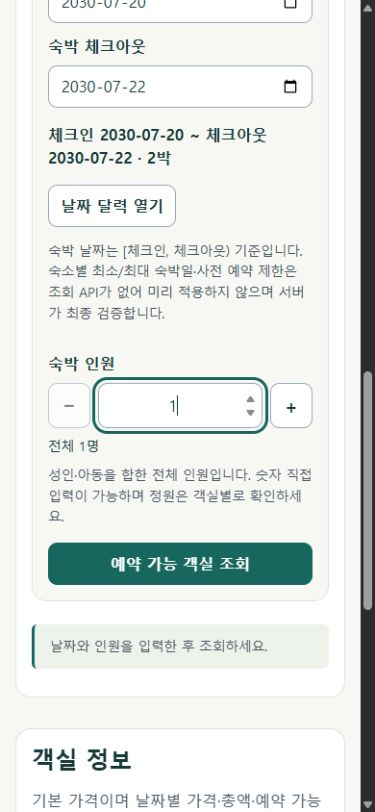

# 전체 숙박 인원 Stepper UX (#242)

2026-10-24(Asia/Tokyo), 최신 `develop`의 `beb0281`에서
`feature/#242-guest-count-stepper`를 생성했다. Backend/API/DB/인증·예약 쓰기 계약은 변경하지 않았다.

## 디자인 참조와 의도적인 차이

구현 전에 [승인 기준](../ui/approved-design.md)을 읽고, 저장소의
`prototypes/premium-travel/index.html`과 `review.html`을 전용 로컬 서버/Browser에서 열었다.
Home A1·Search·Detail의 1440/390 스크린샷과 전체 인원 모달도 확인했다.
성인·아동 합계, −/+ 조작과 객실별 정원 안내를 참조했다.

| 화면 | 적용한 UX | 이번에 적용하지 않은 시안 요소 |
| --- | --- | --- |
| Home A1 | 기존 검색 안에 전체 인원 −/+와 직접 입력 | Cinematic 사진 Hero, Navy/Ivory 전면 교체, 인원 모달 |
| Search | 동일 입력 재사용, URL 인원 복원, 명시적인 검색 제출 | 사진 중심 비교 카드와 필터 Modal 전체 재설계 |
| Detail | 동일 입력, 객실 정원 표시 유지, 조건 변경 시 선택/요금 해제 | 갤러리, 추가 객실 Metadata, 시안의 Booking Panel/Sheet |

시안은 증감 버튼과 숫자 출력만 제공하지만, 실제 앱은 큰 인원도 반복 클릭 없이 입력할 수 있는
기존 `type="number"`를 유지한다. 별도 모달/적용 상태 없이 기존 폼에서 즉시 편집하고
기존 조회 버튼으로만 제출한다. 현재 녹색 Semantic Token·공통 Focus/Disabled 스타일을 재사용했다.
전체 승인 시각 적용은 f0.5.3, 실제 Media/Metadata·정책 읽기 계약은 v0.4.1 후속이다.
가상 사진·가격·정원·성인/아동/유아별 모델이나 요금은 실제 앱에 복사하지 않았다.
세부 조작·서체·색상 전체의 최종 사용자 승인으로 간주하지 않는다.

## 입력·조회 계약

- `components/room/GuestCountField.tsx`는 부모가 소유하는 문자열 Draft를 받는다.
  `api/availabilityValidation.ts`의 기존 양의 정수 검증을 `isValidGuestCount`로 추출하고
  `MAX_GUEST_COUNT`를 공유했다. API는 `Integer guestCount`이며 최소 1명이다.
  `2,147,483,647`은 기존 API 타입의 표현 상한이지 서비스/숙소 최대 정원이 아니다.
- Home 기본 1명, Detail 기본 1명 또는 복귀 조건, Search는 기존 URL 값을 유지한다.
  Home/Search의 빈 선택 인원은 기존처럼 Query에서 생략한다. 인원 조건 없는 검색에
  몰래 1명을 추가하지 않는다. Detail은 필수이므로 빈 값의 제출을 거절한다.
- 최소에서 −, 상한에서 +는 Native disabled다. 소수/음수/0/상한 초과는
  반올림·Clamp하지 않고 오류를 표시하고 두 증감 버튼을 비활성화한다. 직접 수정할 수 있다.
  빈 값은 자동 복구하지 않으며 사용자가 +를 누르면 명시적으로 1명을 선택한다.
  숫자로 표현할 수 없는 문자열의 입력/정제와 Native validation은 기존 number input 동작이다.
- 두 버튼은 `type="button"`으로 암묵적 Form 제출을 막는다. 기존 Label을 유지하고
  `인원/숙박 인원 1명 늘리기·줄이기`, 설명 연결, `aria-invalid`, polite/atomic 전체 인원 안내를 제공한다.
  일반 Tab 이동과 Enter/Space를 사용하며, 버튼이 경계값에서 disabled로 바뀌면 숫자 입력으로
  Focus를 옮겨 화면 본문으로 Focus가 빠지는 것을 막는다.
- Home/Search는 명시적 제출 때 기존 FormData/Query Parser를 사용한다. 검색 폼의 미제출 Draft와
  URL 기준 결과는 구분한다. API 요청·URL은 기존 `guestCount` 하나만 사용한다.
- Detail의 증감/직접 입력은 모두 기존 `useAvailabilityForm.change`를 사용한다.
  선택 객실·가용성 결과·예상 요금을 즉시 제거하고 진행 중 GET을 Abort/늦은 응답 무시 대상으로 만든다.
  재조회/선택 전 기존 결과를 복구하거나 자동 API 호출·예약 쓰기를 하지 않는다.
- 정원은 기존 `RoomResponse.capacity`를 객실 카드와 예약 요약에서 확인한다.
  하나의 객실 정원을 전체 검색 상한으로 적용하지 않는다. 가용성 필터와 최종 서버 검증을 유지한다.
  기존 `BookingFlow`/`bookingState.validateSelection`의 정원 초과 예약 차단도 유지했다.
  예약 일정 변경은 인원 고정이므로 해당 폼에는 Stepper를 추가하지 않았다.

경로는 `frontend/src/` 기준이다. 로그인 후 새 Availability GET, 선택 복원, 예약 생성/변경/취소의
자동 재전송 금지·불명 결과 잠금, `[check-in, check-out)` 및 날짜 달력 동작은 변경하지 않았다.

## 검증

- 관련 6 files / **77 tests**, 최종 전체 **74 files / 1,026 tests** 성공.
  새로운 공통 입력 단위 Suite와 기존 Home Route/Search/Availability Suite를 보강했다.
  최소/상한/잘못된 직접 입력/빈 값/경계 Focus, 암묵 제출 방지, URL 인원 복원,
  선택·요금 해제, 인원 변경 전의 늦은 GET 무시, 정원 초과 빈 결과를 검증한다.
  정원 초과 Booking 차단은 기존 Suite를 실행했으며 중복 Flow Suite는 만들지 않았다.
- `pnpm install --frozen-lockfile --offline`, `pnpm lint`, `pnpm format:check`,
  `pnpm typecheck`, `pnpm test`, `pnpm build`,
  `pnpm exec tsc -p scripts/ui-audit/tsconfig.json`: 모두 성공.
  초기 format/typecheck에서 발견한 포맷과 테스트 Locator 옵션 타입을 보완한 뒤 재검사했다.
- CI Workflow의 install/lint/format/typecheck/test/build 명령을 로컬 Windows,
  Node 24.14.0/pnpm 11.19.0에서 실행했다. CI는 Ubuntu/Node 24.19.0이므로 완전히 같은 환경은 아니다.
  의존성·Lockfile·환경변수·실행/Workflow 설정 변경은 없으며 새 외부 서비스가 필요하지 않다.
  push/PR 미요청으로 원격 CI는 실행하지 않았다. Backend 변경이 없어 Backend test/build도 재실행하지 않았다.

### 실제 Browser 렌더

computer-use 스킬로 [읽기 전용 Audit 도구](../../frontend/scripts/ui-audit/README.md)를 실행했다.
실제 AppRoutes/Component/CSS + HTTP Fixture이며 Backend Proxy/실제 인증/예약 쓰기는 없다.
Home/Search/Detail을 1440×1000·390×844 Viewport에서 시안과 비교했다.
스크린샷은 도구의 Native 내용 영역(1425×990·375×812)을 저장했다.

[측정 JSON](../ui/evidence/242/measurements.json)과 같은 폴더의 11개 JPEG에 증거를 보관했다.
모든 측정에서 document scrollWidth=clientWidth로 가로 넘침 0px,
증감 버튼은 44×46.8px였다. Mobile 숫자 입력 너비는 Home 159px/Search 189px/Detail 171px로
10자리 상한도 표시된다. 키보드 Enter/Space, 숫자 직접 입력, 최소/상한에서 disabled 및 입력 Focus,
소수/빈 값 피드백, 선택 객실/예상 요금 해제를 실제 Browser에서 확인했다.

| 화면/상태 | 증거 |
| --- | --- |
| Home Desktop / Mobile 키보드 | [1440](../ui/evidence/242/home-1440.jpg) · [390](../ui/evidence/242/home-390-keyboard.jpg) |
| Search Desktop / Mobile | [1440](../ui/evidence/242/search-1440.jpg) · [390](../ui/evidence/242/search-390.jpg) |
| Detail Desktop / Mobile 선택 상태 | [1440](../ui/evidence/242/detail-1440.jpg) · [390](../ui/evidence/242/detail-390-selected.jpg) |
| Detail 인원 변경·선택 해제·최소 Focus | [390](../ui/evidence/242/detail-390-invalidated-min.jpg) |
| 직접 입력 상한 / 소수 오류 | [상한](../ui/evidence/242/home-390-max.jpg) · [소수](../ui/evidence/242/home-390-invalid.jpg) |
| Detail 상한 Focus / 빈 필수 값 | [상한](../ui/evidence/242/detail-390-max-focus.jpg) · [빈 값](../ui/evidence/242/detail-390-empty.jpg) |

DOM 테스트를 시각 검증으로 대체하지 않았다. 위 결과는 대표 폭의 읽기 전용 Fixture 렌더이며
실제 Backend 정원 필터/예약 Race, 실제 모바일 기기 Touch, Google 로그인, Screen Reader 음성 출력,
전체 폭/확대 배율·Browser Matrix·최종 사용자 승인은 검증하지 않았다.
Windows AX의 Native 숫자 Value는 최댓값에서 2,147,483,648로 반올림되어 관찰됐지만,
입력 DOM value/화면/AX Details/명시적 인원 안내는 2,147,483,647이었다. 실제 보조공학 검수는 남아 있다.
f0.6.0 실제 연동·최종 UX 검수를 대체하지 않으며, 일반 320px Global Overflow는 기존 #231 범위다.

