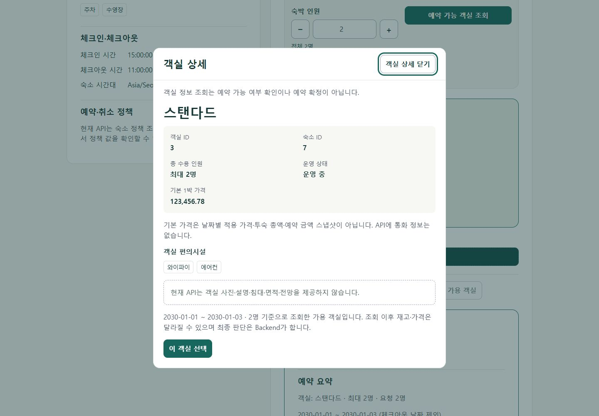
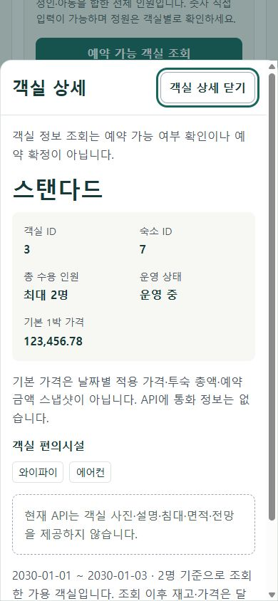
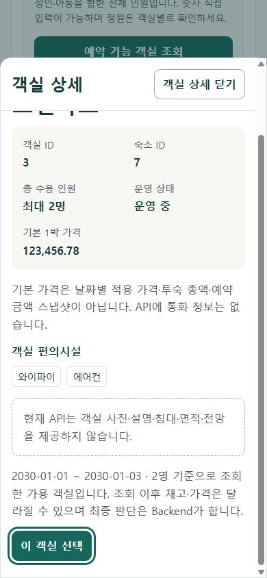

# Room DTO 기반 상세 및 선택 (#244)

검증일: 2026-10-25. #243이 병합된 `develop`에서 진행했다. Backend API/Domain/Schema,
인증·예약 쓰기 계약과 의존성/실행 설정은 변경하지 않았다.

## 구현과 데이터 경계

- 공개 객실 목록과 가용 객실 카드의 **상세 보기**로 진입한다. 관리자 카드에는 추가하지 않았다.
  열 때마다 기존 익명 `GET /api/v1/rooms/{roomId}`를 사용한다. DTO 형식/roomId는 기존
  `getRoom` 검증을 재사용하고, 선택한 숙소의 accommodationId도 대조한다.
- RoomResponse의 **roomId, accommodationId, name, capacity, nightlyPrice, amenities,
  status**만 표시한다. 사진·설명·침대·면적·전망은 API 미제공으로 명시한다.
  가짜 사진, Gallery, 임의 통화·세금·부대요금은 추가하지 않았다.
- `nightlyPrice`는 기본 1박 가격이다. 날짜별 적용 가격·투숙 총액·기존 예약 스냅샷과 다르다.
  명시적 선택 후 기존 BookingSummary가 별도 날짜별 가격 GET으로 예상 합계를 보여주며,
  최종 예약 금액과 재고 판단은 기존 Backend 생성 API가 수행한다.
- 일반 목록 상세는 읽기 전용이다. 날짜/인원을 입력하고 성공한 가용 객실 결과에서 연 상세만
  **이 객실 선택**을 제공한다. 상세도 ACTIVE이고 수용 인원이 충분하며 가용 결과의 이름·정원·
  기본 가격·운영 상태·편의시설과 일치해야 한다. 변경 시 선택 버튼을 막고 상세를 닫아 가용성을
  다시 조회하도록 안내한다. 자동 재조회·객실 대체·쓰기·예약 보장은 하지 않는다.
- 상세 읽기/닫기/뒤로가기 자체는 선택을 바꾸지 않는다. 선택 버튼만 기존 selectedId 경로로
  연결한다. 예약 POST/PATCH나 자동 로그인은 실행하지 않는다. 기존 카드의 직접 선택도 유지했다.
- 상세 GET Loading/Error/404와 수동 Retry를 제공한다. 실패 시 이전 상세를 성공 데이터처럼
  노출하지 않는다. 닫기/Context 변경 시 Abort하고 늦은 응답은 무시한다.

## History, 상태, 접근성

`RoomDetailTrigger`는 현재 URL을 바꾸지 않는 Router history Entry를 추가한다.
`location.state.roomDetail`에는 scope/roomId/accommodationId만 들어간다. 기존 state와
Search/Stay Query는 보존하며, DTO·가격·대표 투숙객·토큰·Scroll 좌표를 새로 저장하지 않는다.
공유 URL은 숙소 탐색 조건을 전달할 뿐 모달 Deep Link가 아니다.

- Close/Escape는 `navigate(-1)`, Back도 같은 Entry를 제거하므로 숙소 화면을 유지하며 상세만 닫는다.
  Forward는 현재 카드 Scope/ID가 일치할 때 새 GET으로 다시 연다. 이전 선택 액션은 재실행하지 않는다.
  History state가 복원되더라도 검증된 현재 카드가 있어야 하며 모달 응답은 다시 읽는다.
- 열고 닫는 동안 기존 Room Page, 날짜/인원 Draft와 선택을 재마운트하지 않는다.
  Scope는 목록 종류·숙소·페이지, 가용 목록은 투숙 조건까지 구분하므로 같은 객실의 두 진입점을 혼동하지 않는다.
- 날짜/인원·숙소/Route 변경은 기존 가용 결과/선택/가격 초기화와 늦은 응답 무시를 유지한다.
  Context를 떠나면서 해제될 때 예전 위치/선택을 다른 화면에 복원하지 않는다.
  로그인 복귀는 기존 #243 계약대로 **새 가용성 GET 후** roomId Hint를 재검증한다.
- native `<dialog>.showModal()`이 배경을 inert 처리한다. 처음에는 닫기에 Focus를 주고
  Tab/Shift+Tab은 현재 활성 모달 버튼 사이를 순환한다. 모바일에서 아래 선택 버튼으로 이동하면
  모달 내부만 스크롤하여 Focus가 보이게 한다. 닫기 Header는 내부 Scroll 중에도 고정한다.
- body/root의 기존 inline overflow 값을 보관하고 열려 있는 동안 Scroll을 잠근 뒤 정확히 복원한다.
  같은 Context에서 닫을 때 #243 Helper로 Trigger Focus/좌표를 복원한다(제목 fallback 포함).
  화면 높이 변화·명시적 선택 후 UI 재배치는 Browser의 Scroll anchoring/Clamp 영향을 받을 수 있다.
  Backdrop 클릭은 닫기 동작으로 추가하지 않았다. 닫기 버튼·Escape·Back을 사용한다.

## 승인 시안 적용과 의도적 차이

작업 전에 [승인 문서](../ui/approved-design.md), 독립 Prototype `index.html`과 `review.html`을
Browser에서 열고 `room-drawer-1440.png`·`detail-390.png`를 직접 확인했다.
Desktop 중앙 모달, Mobile 하단 Sheet, 상세 정보 다음 선택 CTA라는 구조를 적용했다.

현재 녹색 Tokens를 유지했고 Navy & Ivory 전면 적용은 **f0.5.3**에 남겼다. 시안의 객실 사진·
넓은 Gallery·침대/면적/전망을 복제하지 않고 미제공 안내와 실제 DTO 정보로 대체했다.
실제 Media·추가 Room Metadata는 **v0.4.1**, 최종 사용자 승인·전체 반응형 검수는 **f0.6.0** 범위다.
따라서 시안과 픽셀 단위 동일한 완성 화면이라는 주장은 하지 않는다.

## 자동 검증

`RoomDetailTrigger.test.tsx`는 상세 공개 GET, DTO/숙소 ID 거절, 미제공 데이터/가격 경계,
기존 URL/state 보존, Loading/404/500/Retry, 닫기 후 Abort/늦은 응답 무시,
Back/Forward/Cancel, 명시적 선택·미선택 닫기, 비활성/정원·상세 변경의 선택 차단,
Tab 순환, Focus/Scroll 복귀 호출과 Context 이탈을 검증한다.

기존 `RoomAvailabilitySection.test.tsx`에 page 1 유지·상세 선택·인원 변경 무효화를 추가했다.
기존 `BookingCreationFlow.integration.test.tsx`의 익명 탐색→로그인→새 가용성→예약 생성 시나리오에
상세 열기/닫기/선택을 연결했다. 중복 Lifecycle Suite를 만들거나 기존 테스트를 삭제/비활성화하지 않았다.
다른 Booking/Auth/예약관리/Admin 회귀도 전체 테스트에 포함된다.

jsdom은 native dialog top layer·레이아웃·실제 Focus Trap/Scroll을 구현하지 않는다.
`test/dialog.ts`의 테스트 전용 Stub은 open/close 수명만 제공하며, 브라우저 검증의 대체물이 아니다.
실제 기능에 Polyfill/새 의존성을 추가하지 않았다.

실행 결과와 CI 경계:

- `pnpm install --frozen-lockfile --offline`
- `pnpm lint`, `pnpm format:check`, `pnpm typecheck`
- `pnpm test` — **76 files / 1,076 tests 성공**
- `pnpm build`
- `pnpm exec tsc -p scripts/ui-audit/tsconfig.json`

위 명령 모두 성공. Frontend CI와 동일한 검사 항목이지만 로컬 Windows/Node 24.14.0,
CI는 Ubuntu/Node 24.19.0이다(pnpm은 양쪽 11.19.0). 새 패키지/서비스/환경변수나
Workflow 변경이 없다. Push/PR 미요청으로 원격 Actions는 실행하지 않았다.
Backend 변경이 없어 Backend test/build는 재실행하지 않았으며, 로컬 Compose DB/Volume도 건드리지 않았다.

## 실제 Browser 관찰

computer-use 스킬과 [읽기 전용 UI Audit](../../frontend/scripts/ui-audit/README.md)으로
**실제 App Component/CSS**를 1440×1000, 390×844에서 렌더하고 시안과 비교했다.
전체 화면을 저장하여 직접 시각 확인했다. [측정값](../ui/evidence/244/measurements.json)과
같은 폴더의 세 PNG가 원본이다.

- Desktop은 704px 폭의 중앙 모달, Mobile은 390px 전체 폭·90dvh 상한의 하단 Sheet다.
  두 모달 모두 scrollWidth=clientWidth로 내부 가로 넘침이 없었다.
- 닫기 초기 Focus, 양방향 Tab 순환, Escape 닫기와 Trigger Focus 복귀를 실제 키 입력으로 확인했다.
  Mobile에서 마지막 선택으로 Focus 이동 시 내부 scrollTop=113으로 CTA가 화면 안에 들어왔다.
  닫기 Header는 같은 위치를 유지했다. 배경에서 아래로 Scroll해도 페이지 위치는 변하지 않았다.
- Desktop Escape 복귀 scrollY=597. Mobile의 기존 선택 유지 상태에서 열기 전/닫은 후는
  1742→1742, Trigger Focus와 날짜/인원도 유지됐다. Mobile 명시적 선택은 기존 예약 요약·
  로그인 진입 CTA를 표시했다. 실제 로그인이나 예약 생성은 실행하지 않았다.

Audit은 HTTP Fixture + MemoryRouter이다. **실제 Backend/DB·인증/Google·재고 경쟁·쓰기·
Native Browser Back/Forward E2E 증거가 아니다.** History 동작은 Router 자동 테스트로 분리했다.
다른 Browser, 실제 Touch/모바일 가상 키보드, Screen Reader, 실제 SPA Hosting 새로고침과
최종 사용자 UI/UX 승인은 후속 횡단 검증 대상이다.

