# Detail 재구성 — #279

2026-11-04, 새 f0.5.3 / Milestone #21. 기준은 [#279](https://github.com/K4RF/reservation-platform/issues/279),
[#271 명세](prototype-rebuild.md), [승인 원본](approved-design.md)의 Detail + Navy & Ivory다.
#274/275/276 및 #278 PR #292까지 병합된 `develop 783760c`를 pull하고
`feature/#279-detail-rebuild`에서 작업했다. 사용자 최종 시각 승인은 f0.6.0에 남긴다.

## 구조와 상태 소유권

| 영역      | 이전 → 이번 변경                                                                                 | 보존한 계약                                                                       |
| --------- | ------------------------------------------------------------------------------------------------ | --------------------------------------------------------------------------------- |
| 상단      | 제목/상태 뒤 Gallery와 전체 안내 → 검색 복귀·제목/짧은 위치·큰 비대칭 Gallery                    | 실제 Accommodation/Media 응답만 사용, 전체 위치·소개·운영 시간 접근               |
| 본문      | 소개·이용 안내·가용성·별도 기본 목록을 연속 배치 → Nav/소개/주 객실 목록/이용 안내 + 오른쪽 Rail | 기존 URL/검색 복귀, 같은 문서 위치·초점 계약                                      |
| 객실      | 기본/가용 목록 동시 노출 → 날짜 미적용 시 읽기 전용 카탈로그, 적용 후 가용 목록 하나             | 공개 목록/페이지, fresh 상세 GET/Room·Accommodation ID/ACTIVE/정원 검증           |
| 예약      | 선택 즉시 Rail 안 긴 Booking 폼 → 선택/예상 요약과 명시적 계속, 별도 본문 Booking 단계           | 익명은 명시적 로그인, 로그인 복귀 후 새 가용성에서 선택 힌트 검증, 자동 POST 없음 |
| 고정 정보 | static 확인 패널 → Desktop sticky Rail, Mobile fixed CTA                                         | 확대/낮은 높이/모달/입력/오류에서 내부 스크롤·초점·동적 여백으로 접근             |

`AccommodationTitle`/`AccommodationInfo`/`AccommodationOperatingInfo`는 실제 읽기 값의 표현이다.
`RoomAvailabilitySection`이 조건·조회·선택·계속 단계를 소유하고 `RoomExplorationLayout`은
본문/Rail/하단 행동의 표현·초점 이동만 담당한다. SiteHeader/RootLayout/Auth와 쓰기 gate는 이동하지 않았다.
조건 편집 적용 시 기존 가용 결과/선택/가격/Booking 입력이 초기화된다. 날짜/인원 레이어의
preview/cancel은 기존 결과를 유지하며 새 조회/쓰기 없이 닫힌다. 재조회·페이지 이동도 선택을 해제한다.
INACTIVE 숙소는 들어온 일정/객실 힌트가 있어도 카탈로그 읽기만 제공하고 가용 선택을 열지 않는다.

객실 상세는 기존 native Modal/Mobile Sheet와 동일 URL history entry를 재사용한다.
새 상세 응답이 목록 snapshot과 다르거나 INACTIVE/정원·ID 조건이 맞지 않으면 선택할 수 없다.
Back/Forward·닫기/새 GET·늦은 응답 무시·Focus/Scroll 복원 회귀는 기존 Suite를 유지했다.
Gallery는 별도 읽기 전용 레이어다. 누른 사진의 순서에서 열며 닫으면 그 사진 버튼으로 복귀한다.
Room Gallery는 기존 Room 모달 안의 inline 탐색이며 중첩 선택 모달을 만들지 않았다.

Rail은 선택한 객실의 날짜별 가격을 합친 **조회 시점 예상 금액**과 펼침 내역을 한 번 유지한다.
명시적 계속 후 `BookingFlow(showSummary=false)`에 같은 요약을 중복 마운트하지 않아
계속 경계에서 가격 GET/전체 요약을 복제하지 않는다. BookingFlow의 기본 summary 동작은 유지했다.
최종 예약 snapshot/가용성 판단은 기존 서버 계약이며 예상가를 확정 금액으로 저장하지 않는다.
통화·세금·침대/면적/전망·정책·후기·가짜 사진을 만들지 않았다. 정책 GET은 추가하지 않는다.
예약 입력/확인/POST의 더 큰 제품 재구성은 #280이며 이번에는 진입 경계를 분리했다.

## 원본과 실제 Browser 비교

원본 Detail과 제품 React를 각각 1440×900 / 390×844에서 열었다.
Studio/demo 안내/상태 도구는 기존 Audit capture CSS로 제외하고 원본 소스/CSP는 바꾸지 않았다.
제품 사진/숙소는 **격리 UI Audit Fixture**이며 실매물·실제 Backend HTTP 증거가 아니다.
실행/파일/출처는 [evidence README](evidence/279/README.md)를 따른다.

| 구분         | 원본 — 가상 시안                                           | #279 — 가상 Fixture                                             |
| ------------ | ---------------------------------------------------------- | --------------------------------------------------------------- |
| 1440 첫 화면 | 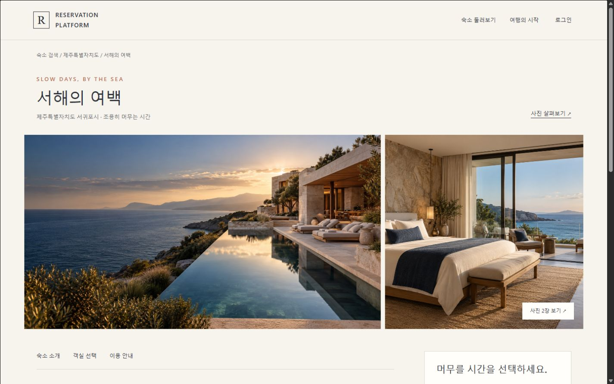           | 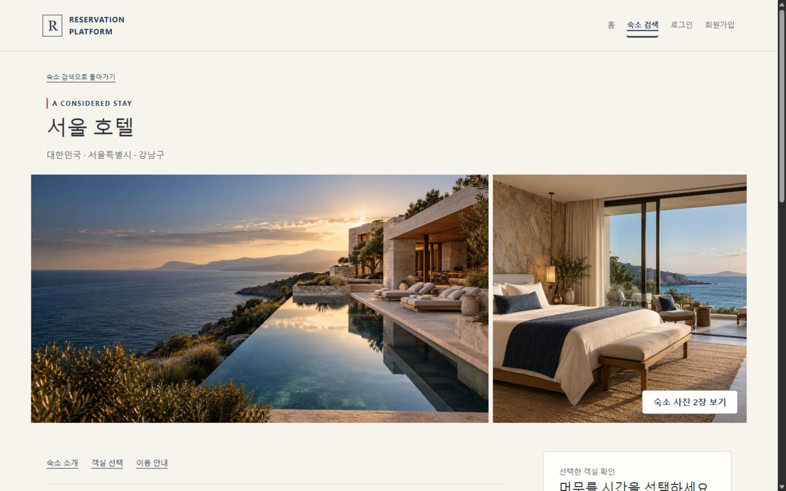           |
| 390 첫 화면  | 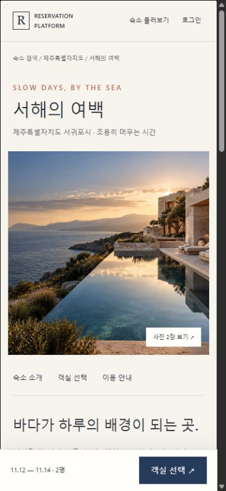             | 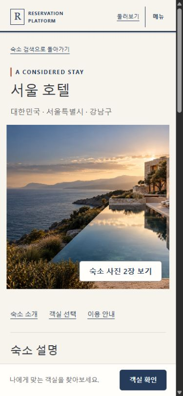             |
| 1440 전체    | 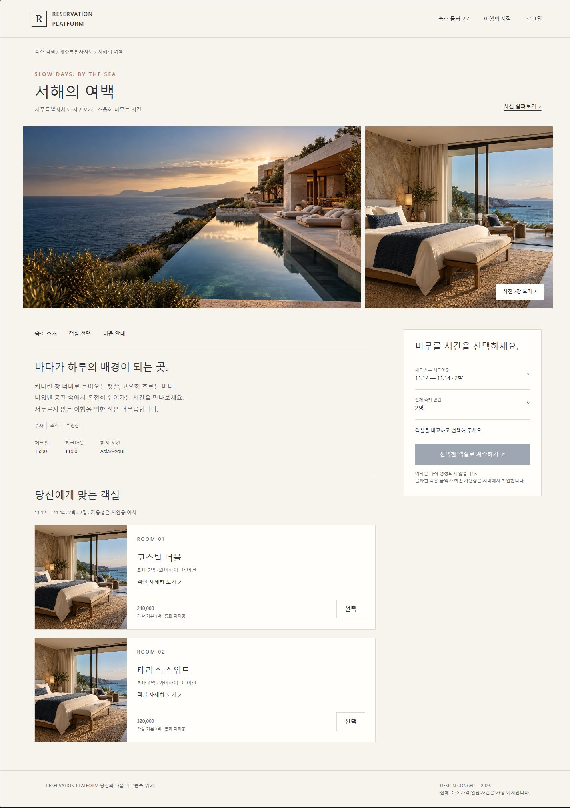 | 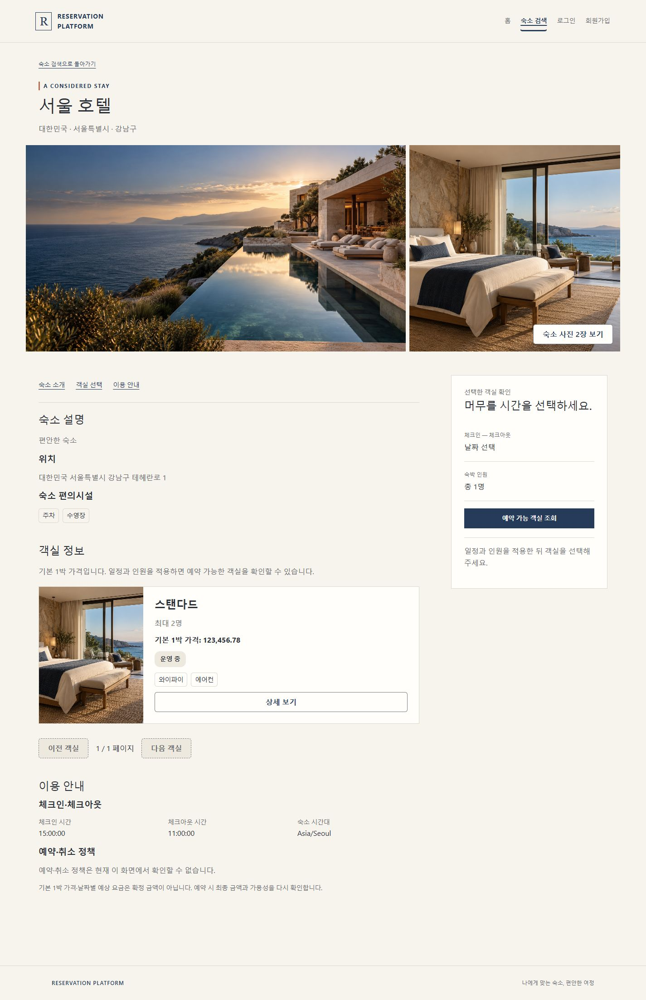 |
| 390 전체     | 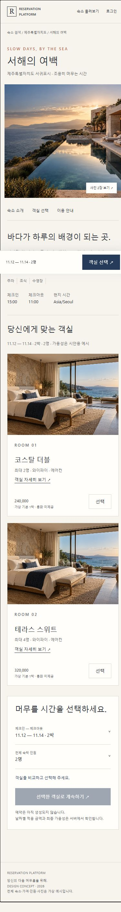   | 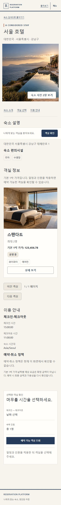   |

동일 시작 위치 scrollY=0의 CSS px다. [원시 실측](evidence/279/measurements.json)은 Footer와 사진 상태도 포함한다.

| 요소                  | 원본 1440 → 구현 1440                     | 원본 390 → 구현 390                     |
| --------------------- | ----------------------------------------- | --------------------------------------- |
| Header 높이           | 94 → 94                                   | 72 → 72                                 |
| Gallery Y / 폭 / 높이 | 316.17 / 1311 / 455 → 320.28 / 1311 / 455 | 259.59 / 347 / 350 → 266.28 / 347 / 350 |
| 본문 시작 Y           | 771.17 → 775.28                           | 609.59 → 616.28                         |
| 첫 객실 카드 Y / 높이 | 1311.78 / 262 → 1292.81 / 303.47          | 1089.63 / 502.38 → 1139.41 / 547.47     |
| 미선택 Rail 폭 / 높이 | 345 / 416.86 → 345 / 471.17               | 331 / 441.36 → 331 / 501.17             |
| 하단 CTA 높이         | 비노출 → 비노출                           | 72.09 → 69                              |
| Footer Y / 높이       | 1925.78 / 93.28 → 2128.97 / 76.19         | 2687.73 / 123 → 3023.77 / 99.38         |

Desktop은 본문840 + gap70 + Rail345(원본 본문839)이며 Gallery는 1.8:1 비대칭이다.
Mobile은 대표 사진 한 장과 전체 보기, 객실 1열이다. 원본은 가상 객실2개/미리 채운 일정,
제품 정상 비교는 카탈로그 객실1개/날짜 미적용이다. 전체 페이지 높이는 동일 데이터 golden이 아니다.
제품은 실제 주소/운영 시간/정책 미제공 안내·44px 상세 조작을 유지해 카드/본문이 더 길다.
원본의 임의 가격/짧은 시연 로직은 복사하지 않았다. 서체/카피·기본 정보 밀도 차이는 남아 있으며
pixel-identical 완료나 사용자 승인으로 보고하지 않는다.
Viewport export의 스크롤바 제외/리샘플링과 full-page 재배치를 구분한다. CSS 콘텐츠 폭은1425/375이며,
정상 파일은 Viewport 1425×891/375×812, full-page 제품1425×2205/375×3123,
원본1425×2020/375×2812이다. 원본은 reload 후 사진을 로드하고 같은 시작 위치에서 측정했다.

## 선택·레이어·가림 방지 검증

| Desktop 선택 후                                 | Mobile 선택 후                                     |
| ----------------------------------------------- | -------------------------------------------------- |
| 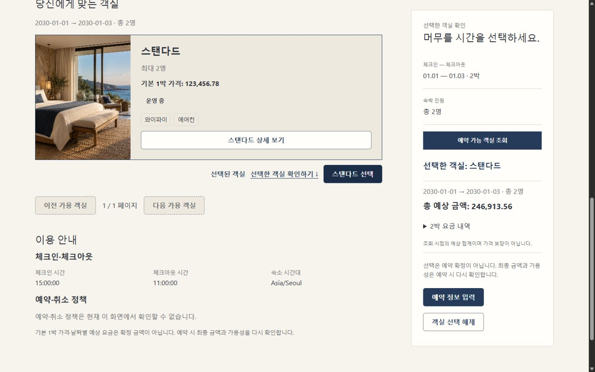    | 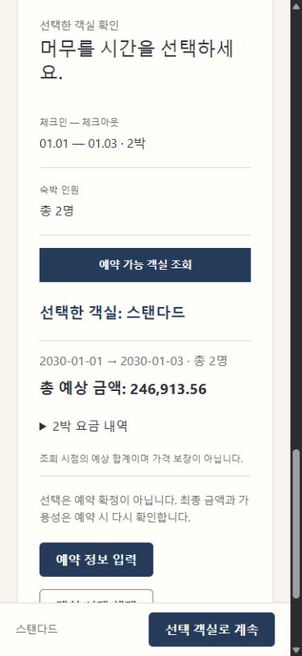 |
| 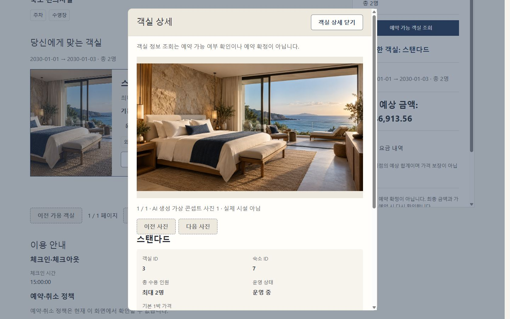 | 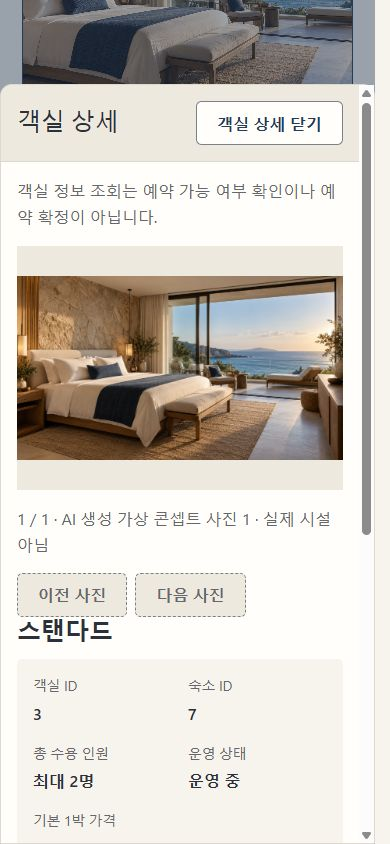     |

관찰값은 [states.json](evidence/279/states.json)에 있다. 상태 캡처는 개발 중 상호작용 증거이며
최종 정상 시작 위치의 비교 수치는 measurements 파일로 구분한다.

- Desktop Rail은 sticky top24, 최대높이 `100dvh - 48px`, overflow-y:auto이며 자체 키보드 초점도 제공한다.
  선택/요약 밀도를 조정한 뒤 1440×900에서 높이813.89, top24로 전체 조작이 들어왔다.
  Tab으로 예약 입력 버튼 Y696.89~740.89에 접근했다. 더 긴/확대 내용은 Rail 내부에서 스크롤한다.
- 1024px 이하에서는 Rail이 본문 흐름으로 전환되고 Mobile CTA를 고정한다. ResizeObserver로
  실제 CTA 높이만큼 본문 끝 여백을 확보하고 safe-area padding을 더한다. 이름은 CTA에서만 두 줄로
  제한하고 카드/Rail에는 전체 이름을 보존한다. focused 본문 조작은 CTA 위로 이동한다.
- 입력 focus와 native dialog 동안 하단 CTA를 숨겨 키보드/모달과 경쟁하지 않는다.
  높이512px 이하에서는 CTA도 일반 흐름으로 바꾸며 같은 계속/이동 조작은 남는다.
  정상 화면 전체를 static으로 대체한 것이 아니라 낮은 높이에서만 고정 표현을 해제한다.
- Gallery 두 번째 사진에서 열기/Shift+Tab 순환/Escape를 확인했다. 사진2 버튼 초점과 선택/금액은 유지됐다.
  Mobile Gallery에도 별도 dialog 하나만 열렸고 CTA는 숨겨졌다.
- Mobile Room Sheet에서 Shift+Tab으로 마지막 선택 버튼 Y775.41~819.41에 도달했다.
  Escape 후 scrollY1237→1237, 원래 상세 Trigger 초점/선택 유지, body/root lock 해제를 확인했다.
- Mobile 마지막 선택 해제 버튼은 Y514.89~558.89로 CTA top775보다 위였다.
  하단 계속은 Booking 제목에 초점을 주며 처음으로 입력 폼 하나만 열었다. 실제 POST는 누르지 않았다.
  빈 입력 검증 후 확인 버튼 Y653.30~697.30도 CTA 위였고 입력 focus 시 CTA는 숨겨졌다.
- 조건 적용으로 가용 목록→카탈로그가 전환될 때 새 날짜/인원 Trigger에 초점을 복원한다.
  최종 Browser 재검증에서 인원 적용 후 카탈로그1/가용 목록0·선택 해제·인원 Trigger 초점,
  명시적 조회 후 카탈로그0/가용 목록1·객실 제목 초점, 날짜 적용 후 날짜 Trigger 초점/잠금 해제를 확인했다.
- 320px 긴 문자열에서 scrollWidth305, 390px/200% root 확대에서375였다.
  긴 이름을 버튼에 반복하지 않고 접근 가능한 이름에 보존했다. 200% 긴 이름의 CTA 높이는170.03이며 실제 측정 높이만큼 여백을 둔다.
  390×420/200% 날짜 Dialog는 Y33.61~420, clientWidth=scrollWidth310이었다.
  취소 후 선택/요약 유지·잠금 해제를 확인했다. 같은 짧은 화면의 날짜 검증 오류는 중앙으로 이동해 초점이 Y57.30~363.23에 들어왔다.
- Media missing은 사진0/작은 대체 표현, partial/failed는 실제 파일404로 검증했다.
  Room 사진이 실패해도 상세 닫기·기본 정보가 유지됐다. Empty 가용성은 선택 버튼0이며 기존 조건을 유지한다.
  Detail Error/Loading은 별도 캡처했다. 가용성 오류/재시도·stale 응답은 기존 DOM 테스트로 검증했다.

## 테스트·CI

기존 CatalogImage/DetailPage/RoomAvailability/RoomDetailTrigger/Navigation/BookingCreationFlow와
공유 bookingFlow helper, 디자인 책임 회귀를 확장했다. 새 전체 Lifecycle Suite를 복제하거나 테스트를 disable하지 않았다.
Gallery 순서/클릭 복귀, 목록 전환, inactive 숙소, 명시적 계속·중복 가격 조회 없음,
CTA 무요청 이동을 추가했다. 로그인 후 새 가용성·ID/정원/상세 변경·한 번의 POST와 실패 잠금도 유지했다.

`frontend/`에서 실행:

```powershell
pnpm install --frozen-lockfile
pnpm lint
pnpm format:check
pnpm typecheck
pnpm test --reporter=json --outputFile=node_modules/.cache/full279.json
pnpm build
pnpm exec tsc -p scripts/ui-audit/tsconfig.json
node --check scripts/ui-audit/server.mjs
```

전체 **80개 파일 / 1,164개 테스트 통과**. 관련 테스트와 lint/format/typecheck/build/Audit 검사도 통과했다.
package.json/lockfile/환경변수/Vite/Actions/Backend는 변경하지 않았다. Frontend CI의
frozen install→lint→format→typecheck→test→build와 pnpm action SHA 고정을 확인했다.
로컬 Windows Node24.14.0/pnpm11.19.0과 CI Ubuntu Node24.19.0/pnpm11.19.0은 구분한다.

## 미검증·후속

Browser는 실제 React/CSS + 격리 읽기 Fixture다. 실제 Backend HTTP/로그인/DB/실매물 사진,
native Browser Back/Forward E2E와 원격 CI를 증명하지 않는다. Back/Forward는 기존 DOM Router 회귀로 확인했다.
200%는 root/rem 확대이고420px는 짧은 Viewport이지 실제 Browser Zoom/OS 확대/가상 키보드가 아니다.
실기기 safe-area/키보드와 실제 Media/Auth/예약 전체 연동은 #284/f0.6.0에서 확인해야 한다.
Backend test/build는 Backend 변경이 없어 재실행하지 않았고 개발 Compose DB/Volume/파일도 변경하지 않았다.
이번 요청은 로컬 브랜치/작업별 커밋까지이며 push/PR 생성/병합/이슈 종료는 하지 않는다.
