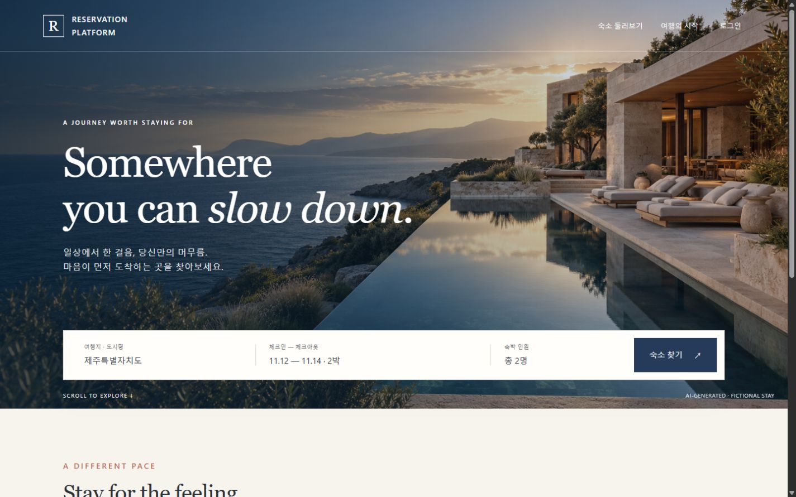
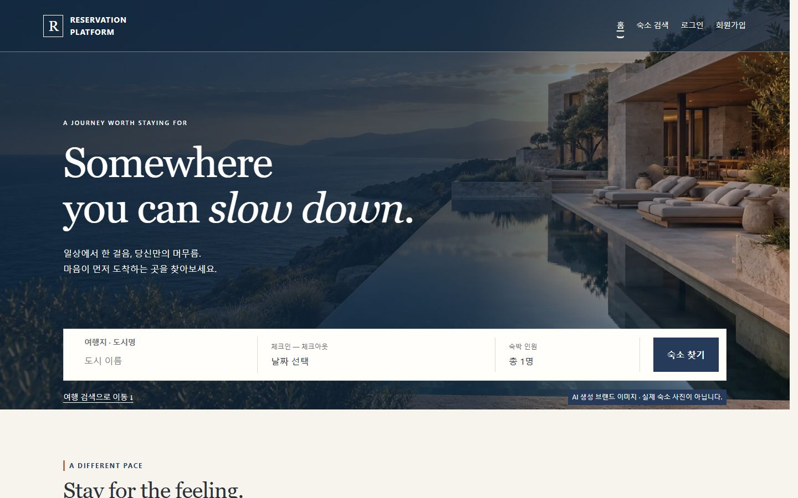
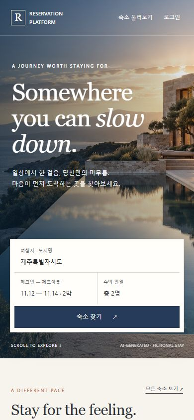
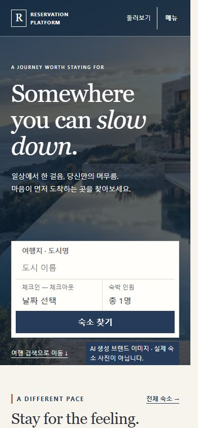
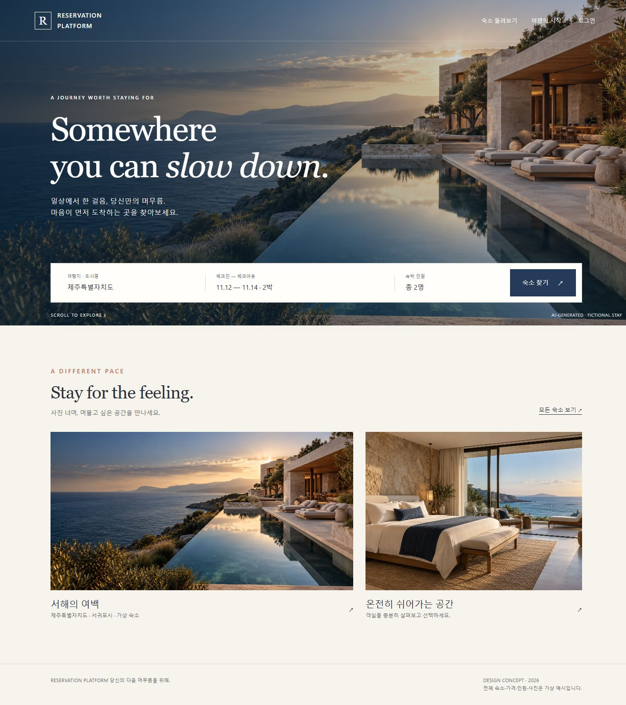
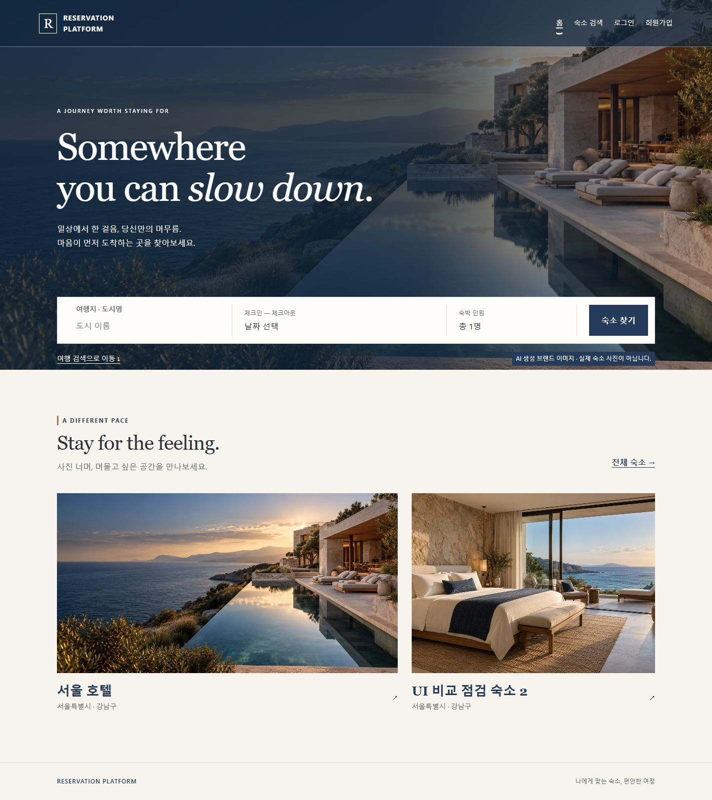
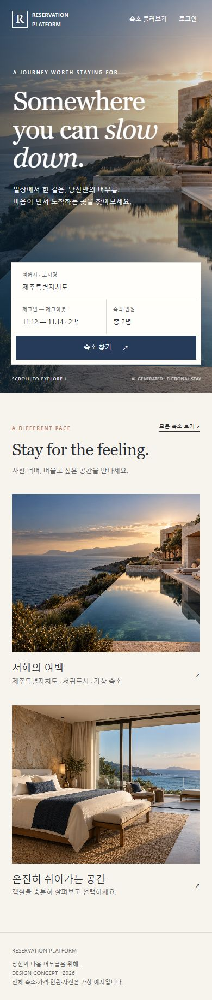
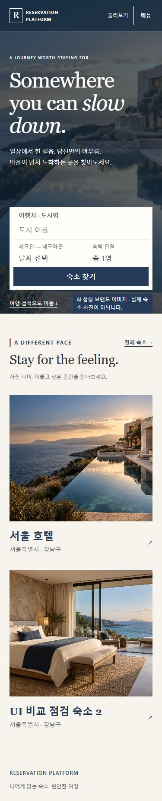

# Home A1 재구성 — #277

2026-11-03, 새 f0.5.3 / Milestone #21. 기준은 [#277](https://github.com/K4RF/reservation-platform/issues/277),
[#271 명세](prototype-rebuild.md), [승인 원본](approved-design.md), Home A1 + Navy & Ivory다.
선행 #274 프레임, #275 검색 레이어, #276 Media 연결이 병합된 `develop c172ef3`에서
`feature/#277-home-a1-rebuild`를 분기했다. 과거 #253 구현이나 테스트 통과를 사용자 승인으로 간주하지 않는다.

## 구현과 책임

| 영역   | 이전 / 이번 변경                                                                                           | 유지한 계약                                                                                           |
| ------ | ---------------------------------------------------------------------------------------------------------- | ----------------------------------------------------------------------------------------------------- |
| Hero   | 건물이 없는 절벽 → 바다·숙소 건축·따뜻한 빛의 장식용 A1 이미지. 좌측 serif 제목의 첫 줄을 Somewhere로 분리 | 실제 숙소 사진이 아니라는 한 곳의 AI 고지, 로컬 srcSet, 이미지 실패 시 검색 유지                      |
| 프레임 | 기존 SiteHeader의 이미지 위 Header와 RootLayout/Footer 재사용                                              | Auth/logout, 소비자/ADMIN 메뉴와 mutation gate 소유권은 이동하지 않음                                 |
| 검색   | Hero 내부 하단 compact bar, 검색 이동 링크와 출처 고지는 별도 flow footer로 정리                           | CompactSearchBar / SearchLayer 재사용, 날짜·인원 draft/적용/submit 분리, 최소 1박·전체 인원·URL 검증  |
| 탐색   | 일반 검색 결과 카드 → Stay for the feeling. 사진 중심 1.4:1 grid, Mobile 1열                               | 공개 ACTIVE 카탈로그 GET 및 실제 대표 Media만 사용. 가짜 가격·인기·후기·시설 정보 없음                |
| 상태   | 미제공 사진은 작은 안내, 실패 사진은 읽을 수 있는 대체 상태. 목록 Loading/Error/Empty 분리                 | 이미지 실패 시 링크/검색 유지. 명시적 목록 retry만 허용, 가입 완료 알림 유지, 로그인 status는 sr-only |

`HomeCatalog`는 마운트당 `GET /api/v1/accommodations?status=ACTIVE&page=0&size=2&sortBy=ID&direction=ASC`
한 번을 요청한다. 명시적 retry/remount는 별도 읽기다. 별도 숙소 상세/객실/요금 GET이나
가격 집계는 없다. 응답 순서대로 ACTIVE 최대 2개를 표시하고 한 개면 전체 열을 사용한다.
브라우저의 이미지 파일 GET은 JSON 조회 횟수와 별개이며 탐색 사진은 lazy다.
이는 전체 숙소 중 ID순 일부이지 추천·인기 순위가 아니다.

사진 링크는 기존 `explorationDetailPath(id, '')`를 사용한다. Home에서 아직 제출하지 않은
도시/날짜/인원을 링크에 섞지 않는다. 제출은 기존 검색 Route/Query로 이동한다.
사진 카드에는 응답의 name, city/region만 표시하고 구조화 위치가 없으면 address를 그대로 표시한다.
대표 Media가 없거나 실패해도 가상 이미지를 보충하지 않는다.

브랜드 자산의 단일 상세 기록은 [brand README](../../frontend/src/assets/brand/README.md)다.
이슈가 허용한 reference-only 용도 변경을 [ASSETS](prototypes/premium-travel/ASSETS.md)에도 명시했다.
기존 콘셉트를 기계적으로 WebP 변환했으며 새 이미지 생성/외부 사진 수집/실제 Media 등록은 하지 않았다.
800/1600 파일은 각각 52,228/153,676 bytes다. 이전 #253 자산은 역사 기록으로 남기되 Home에서 import하지 않는다.

## 원본과 실제 화면 비교

실제 Browser에서 원본 A1과 제품 React를 각각 열었다. 제품 캡처의 숙소/사진은 **격리 UI Audit Fixture**다.
프로덕션 코드에 가상 catalog를 넣지 않았고, 실매물 사진/실제 Backend E2E의 증거도 아니다.
실행 URL과 상태별 증거는 [evidence README](evidence/277/README.md)를 따른다.

원본 캡처는 Audit 서버의 allowlist 읽기 경로에서 원본 HTML/CSS/JS/이미지를 제공하고
외부 capture.css로 Studio만 숨겼다. 원본 파일·CSP·Hero/카드 스타일은 바꾸지 않았다.
도구바 높이를 제품 여백으로 비교하지 않는다. 아래는 각각 첫 Viewport와 전체 페이지다.

| 구분         | A1 원본 — 가상 시안                                      | #277 구현 — 가상 Audit 데이터                          |
| ------------ | -------------------------------------------------------- | ------------------------------------------------------ |
| 1440 첫 화면 |            |            |
| 390 첫 화면  |              |              |
| 1440 전체    |  |  |
| 390 전체     |    |    |

Viewport는 1440×900 / 390×844로 설정했다. 아래 값은 Studio가 없는 시작 위치 scrollY=0의
DOM 실측이며 단위는 CSS px다. 원시 rect는 [measurements.json](evidence/277/measurements.json)에 있다.
Scrollbar를 포함한 Viewport와 콘텐츠 폭(1425/375)을 구분한다. IAB 이미지 export는
스크롤바 제외·리샘플링 또는 full-page의 재배치가 발생하므로 파일 픽셀과 CSS px를 동일시하지 않는다.
특히 원본 Mobile full-page는 390px canvas, 제품 full-page는 375px 콘텐츠 canvas로 내보내졌다.
첫 Viewport 실측/전체 흐름을 함께 비교했으며 pixel-identical 승인을 주장하지 않는다.

| 요소                  | 1440 원본 → 구현          | 390 원본 → 구현           |
| --------------------- | ------------------------- | ------------------------- |
| Header 높이           | 94 → 94                   | 72 → 72, 한 줄            |
| Hero 높이             | 740 → 740                 | 720 → 720                 |
| h1 시작 Y / 높이      | 253.3/164.8 → 253.6/163.1 | 159.8/155.8 → 159.4/155.8 |
| 검색 Y / 높이         | 597.8/90.3 → 594.3/93.8   | 480.1/187.9 → 474.9/190.8 |
| 첫 탐색 사진 Y / 높이 | 982.2/360 → 986.8/360     | 940.9/290 → 907.0/290     |
| Footer 시작 Y / 높이  | 1509.2/93.3 → 1525.0/76.2 | 1744.1/123 → 1739.5/99.4  |

### 남은 시각 차이와 이유

- 같은 바다/건축 원본과 62%/63% center crop을 사용한다. 다만 기존 토큰의 Header 및
  Mobile Hero Navy scrim은 원본보다 강하다. 밝은 사진 위 최소 대비 4.5:1을 검증하는 기존 테스트를
  유지했다. 따뜻한 빛이 더 어둡게 보이는 차이는 최종 검수 대상으로 남기며 자동 승인 예외로 보지 않는다.
- Header는 실제 로그인/가입 및 메뉴/ADMIN 경로를 유지한다. 시안의 단순 가상 메뉴를 복사하지 않았다.
- 미선택 도시/일정, 총 1명으로 시작한다. 시안의 제주·11월 일정·총 2명은 제품 기본값으로 복사하지 않았다.
  검색/이동 링크는 44px 최소 조작 높이를 유지해 bar와 고지의 높이에 소폭 차이가 있다.
- Mobile 탐색의 짧은 전체 숙소 CTA와 제목/문구 reflow 때문에 사진 시작이 Viewport 실측상 약34px 빠르다.
  Caption은 실제 숙소명/위치이며 시안의 가상 숙소/객실 소개·가격을 복사하지 않았다. 1개/0개도 정상 상태다.
- Footer는 실제 제품의 공유 문구를 유지하고 시안의 디자인 데모 설명은 넣지 않았다.
  Search/Detail 전체 Layout은 #278/#279이고 f0.6.0 사용자 최종 UI/UX 승인은 별도다.

## 검증

실행 위치는 frontend, Windows PowerShell, Node **24.14.0**, pnpm **11.19.0**이다.

| 명령 / 검증                                                                                | 결과                                                                                     |
| ------------------------------------------------------------------------------------------ | ---------------------------------------------------------------------------------------- |
| pnpm test (전체 Vitest runner, JSON reporter 사용)                                         | 80 files, 1,156 tests 통과, 0 실패                                                       |
| routes / BookingCreationFlow / designTokens / uiAuditFixtures 집중 실행                    | 4 files, 71 tests 통과                                                                   |
| pnpm lint / pnpm typecheck / pnpm format:check / pnpm build                                | 통과                                                                                     |
| pnpm exec tsc -p scripts/ui-audit/tsconfig.json / node --check scripts/ui-audit/server.mjs | 통과                                                                                     |
| Audit reference GET/CSS/CSP 유지·allowlist 404·POST 405                                    | 로컬 HTTP로 확인                                                                         |
| Browser 정상 1440/390                                                                      | Hero/검색/사진 2개/전체 페이지/Footer 확인, lazy 사진은 실제 스크롤 후 로드 확인         |
| Browser 실패·Empty                                                                         | Hero404, 일부 Media404, 미제공, 목록 Loading/Error/Empty 표시 확인                       |
| Browser 접근성                                                                             | 320px 긴 문자열, 390px root text/rem 200%, 날짜/인원/메뉴 Escape와 초점·스크롤 복구 확인 |

기존 routes Suite에 단일/2개/초과·INACTIVE 응답, 실제 Media·legacy address·실패,
검색 초안 유지, Loading→오류→명시적 retry→Empty, 이동 시 abort/늦은 Home 응답 무시를 추가했다.
기존 Hero 실패/날짜·인원·검색 검증 및 BookingCreationFlow, 로그인/가입, 예약 관리,
ADMIN mutation/no-replay Suite를 삭제/disable하거나 복제하지 않았다.
CSS 테스트는 흐름·토큰·대비·자산 budget을 확인하며 DOM 테스트가 실제 Layout을 증명한다고 주장하지 않는다.

Browser의 320px에서는 scrollWidth=305≤320, 200%에서는 375≤390이었다.
200%는 Audit root font-size=32px의 글자/rem 재배치이지 Browser Zoom/실기기 키보드 검증이 아니다.
확대 시 Hero는 내용에 맞춰 약1965px로 늘어나며 검색은 그 안의 정상 flow에 남는다.
날짜 Escape 후 숙박 날짜 선택, 인원 초안 취소 후 인원 선택으로 focus가 돌아오고,
적용 전 +1은 총 1명에 반영되지 않았다. body scroll lock과 열린 dialog가 남지 않았다.
문서 overflow:hidden으로 문제를 숨기지 않았다.

### CI·실제 HTTP 경계

`.github/workflows/frontend-ci.yml`의 lint/format:check/typecheck/test/build 단계와
pnpm frozen lockfile 설치 조건을 검토했다. dependency, lockfile, Vite 실행 설정,
환경변수, Backend, Docker Compose, CI YAML은 변경하지 않았다. Audit-only 경로/Fixture는
Production main에서 import하지 않으며 build에는 새 local WebP 2개가 포함된다.
Backend 변경이 없어 Backend 테스트는 이번에 재실행하지 않았다.

GitHub Actions는 Node **24.19.0**, pnpm11.19.0, Ubuntu이며 로컬 Node 패치/OS가 다르다.
원격 CI/깨끗한 Linux frozen install의 통과를 대신 주장하지 않는다. 이번 요청에는 push/PR이 없어
원격 실행도 하지 않았다. 실제 Backend HTTP/실매물 사진·OAuth2·Browser 예약 쓰기·물리 키보드/안전영역은
이번에 재검증하지 않았다. #276의 실제 HTTP 기록은 그 이슈의 증거로만 유지한다.
최종 사용자 승인/실기기 검수와 후속 화면 통합은 남아 있다. Issue를 자동 종료하지 않는다.
