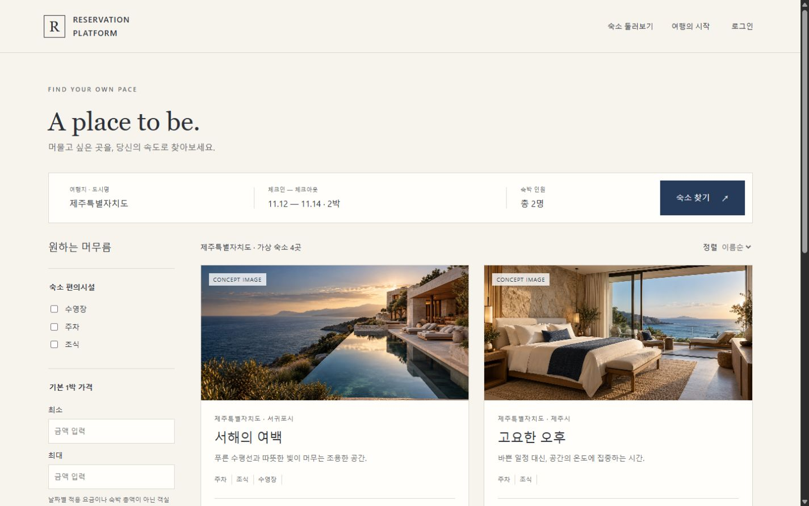
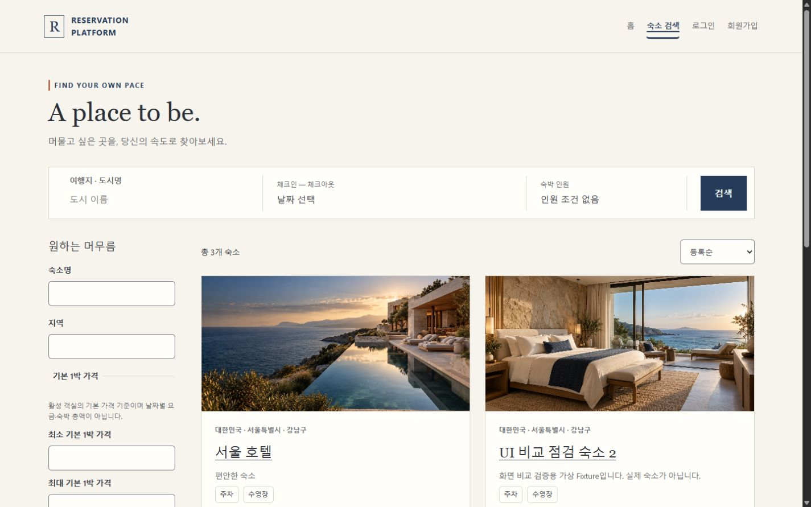
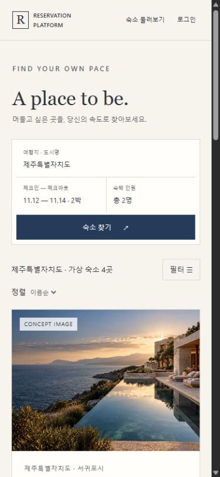
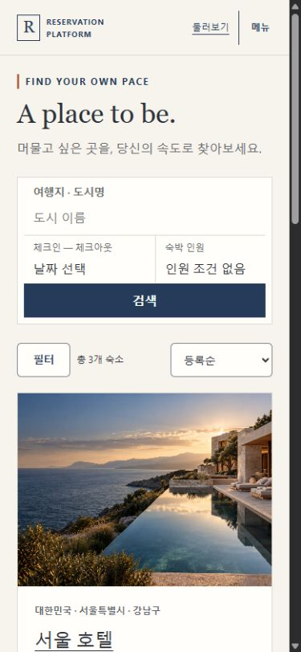
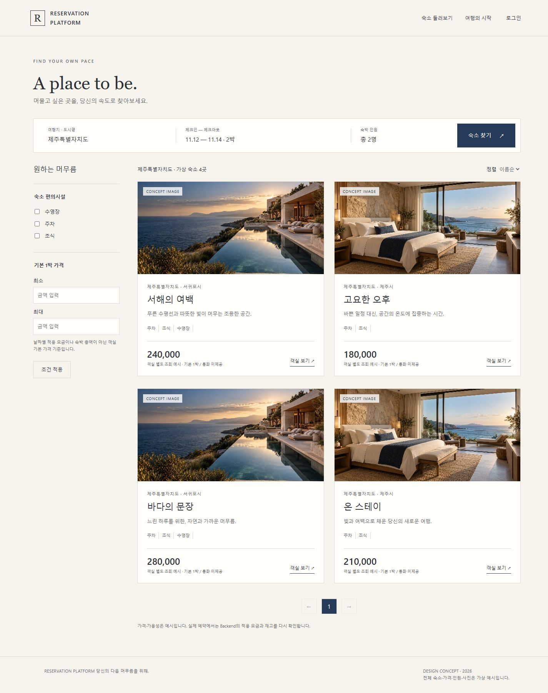
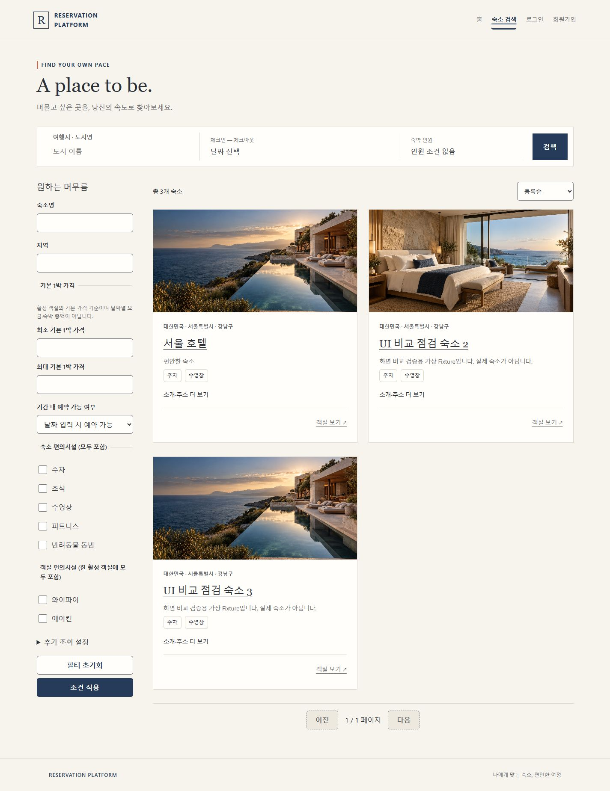
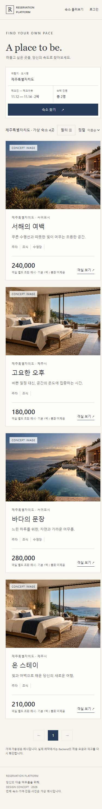
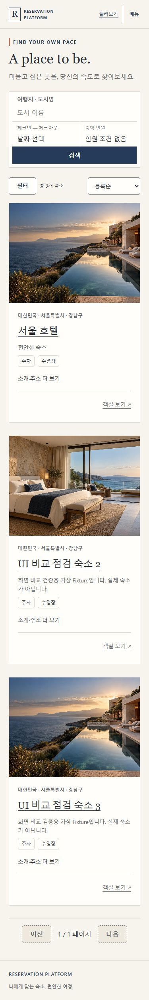
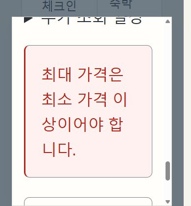

# Search 재구성 — #278

2026-11-03~04, 새 f0.5.3 / Milestone #21. 기준은 [#278](https://github.com/K4RF/reservation-platform/issues/278),
[#271 명세](prototype-rebuild.md), [승인 원본](approved-design.md)의 Search + Navy & Ivory다.
#274 프레임·#275 검색 레이어·#276 Media·#277 Home/CI 수정이 병합된 `develop 6fb7055`에서
`feature/#278-search-rebuild`를 분기했다. 과거 #254 구현/테스트를 사용자 시각 승인으로 간주하지 않는다.

## 구현과 계약

| 영역      | 이전 → 이번 변경                                                             | 유지한 경계                                                         |
| --------- | ---------------------------------------------------------------------------- | ------------------------------------------------------------------- |
| 위계      | 긴 적용 조건·정렬/도움말 → editorial 제목, Compact 조건, 결과 도구/사진 카드 | 기존 SiteHeader/RootLayout, 공개 카탈로그 탐색                      |
| 필터      | 한 검색 Form·좁은 화면 native details → 독립 Sidebar/모바일 Dialog Sheet     | 기존 필터·AND 의미·문자열 가격 정밀도·URL 검증                      |
| 카드      | 긴 위치/안내 → 짧은 위치·소개·편의시설·객실 보기 CTA                         | #276 실제 representativeImage 재사용, 긴 소개/상세 주소는 펼쳐 읽기 |
| 운영 설정 | 주요 검색 도구 → 필터 안의 추가 조회 설정                                    | 기존 size/status URL, ACTIVE 기본값 보존, INACTIVE 명시             |
| 정렬      | 별도 긴 블록 → ID/NAME × ASC/DESC 선택 즉시 적용                             | 가격/인기/후기 정렬을 만들지 않음                                   |

`AccommodationSearchForm`은 제출된 URL, Compact 조건 초안, 필터 초안을 구분한다.
Compact 검색은 현재 적용된 필터와 자신이 제출한 도시/날짜/인원만 합친다. 필터 적용은
현재 제출된 도시/날짜/인원/정렬과 필터 초안만 합친다. 정렬은 제출된 조건에만 적용한다.
새 제출은 page=0이며 다른 편집기의 미제출 초안은 이어 붙이지 않는다. Compact 조건이
달라졌을 때만 기존 결과의 도시/기간/인원을 알리는 안내를 표시한다. 전체 적용 요약은 SR용으로 유지한다.

모바일 필터는 기존 `SearchLayer`의 native dialog/scroll lock/visualViewport 대응을 재사용한다.
초기화는 초안만 비우며 기존 size/status는 유지한다. 적용 전 취소·Escape·backdrop은
URL/조회/선택을 바꾸지 않는다. 넓은 화면으로 바꿔도 열린 편집기는 하나만 유지하고,
취소 시 사라진 모바일 Trigger 대신 Sidebar 제목으로 초점을 넘긴다.
필터 오류에 초점을 이동해 스크롤 영역 안에서 메시지와 적용 버튼에 도달할 수 있게 했다.
새 검색 완료는 결과 제목에 초점, POP/상세 복귀는 기존 카드 위치·Trigger 복원을 우선한다.

카드는 목록 응답의 실제 Media/텍스트만 사용한다. 첫 이미지 eager, 나머지 lazy이며
미제공 사진은 작은 안내, 파일 실패는 사진 슬롯 안의 대체 상태다. 가짜 가격·평점·후기·사진을
채우지 않는다. 기본 1박 필터는 활성 객실의 base price이지 날짜별 합계가 아니다.
카드별 Room/숙소 상세 JSON GET 또는 가격 집계는 추가하지 않았다. 이미지 파일 GET은 별개다.
제목/객실 CTA 모두 기존 canonical search 문맥과 문서 수명 UI-only 위치를 보존한다.
Detail에서 사용하는 전체 `location` 모델은 유지하고 카드에만 `shortLocation`을 사용한다.
Auth/신규 가용성/예약 선택/쓰기 재실행 금지 로직은 바꾸지 않았다.

## 시안과 실제 Browser 비교

아래 구현은 **격리 UI Audit Fixture**다. 프로덕션에 가상 카탈로그를 추가하거나 개발 DB에
사진을 등록하지 않았다. 원본도 가상 시안이다. 원본 HTML/CSS/JS/CSP는 그대로 제공하고,
외부 capture CSS로 Studio와 demo 안내/상태 도구만 제외했다. 실행 URL/파일은
[evidence README](evidence/278/README.md)에 있다.

| 구분         | 원본 Search                                                | #278 구현 — Fixture                                             |
| ------------ | ---------------------------------------------------------- | --------------------------------------------------------------- |
| 1440 첫 화면 |            |            |
| 390 첫 화면  |              |              |
| 1440 전체    |  |  |
| 390 전체     |    |    |

Viewport 1440×900 / 390×844, 동일 시작 위치 scrollY=0의 CSS px 실측이다.
사진을 스크롤로 로드한 후 다시 처음으로 돌아와 Viewport → 전체 순서로 촬영했다.
원시 rect/사진 로드 상태는 [measurements.json](evidence/278/measurements.json)에 보관했다.

| 영역                 | 원본 1440 → 구현 1440             | 원본 390 → 구현 390               |
| -------------------- | --------------------------------- | --------------------------------- |
| Header 높이          | 94 → 94                           | 72 → 72                           |
| Compact bar Y / 높이 | 306.89 / 90.25 → 295.67 / 93.75   | 245.59 / 187.88 → 229.03 / 190.75 |
| 첫 카드 Y / 높이     | 470.58 / 506.27 → 489.42 / 545.13 | 547.34 / 512.27 → 507.78 / 551.13 |
| 카드 폭·열 수        | 478.5 × 2 → 478.5 × 2             | 335 × 1 → 331 × 1                 |
| 사진 높이            | 240 → 240                         | 250 → 250                         |
| 구현 Footer Y / 높이 | 1772.67 / 76.19                   | 2405.66 / 99.38                   |

Desktop Sidebar는 225px, 결과와 간격 46px이며 1024px 이하에서 Trigger/Sheet로 전환한다.
768px 이하 카드는 1열이다. 원본보다 Desktop 첫 카드가 약19px 아래, Mobile은 약40px 위다.
실제 44px 도구/CTA와 소개·주소 접근 경로를 유지해 카드가 약39px 길다. Mobile 좌우 여백도
22px로 원본 20px와 다르다. 제목/본문 서체·실제 데이터 길이 차이를 포함하며 pixel-identical 완료를 주장하지 않는다.
원본 4개 가상 카드와 달리 제품 기본 ACTIVE Fixture는 3개다. 따라서 전체 높이/Footer 위치는
같은 데이터의 golden 비교가 아니다. Media 없는 상태를 정상 사진 완성 화면 대신 제시하지 않는다.

IAB export는 스크롤바 제외/리샘플링이 있어 CSS Viewport와 파일 픽셀을 구분한다.
이번 정상 Viewport 파일은 1425×891 / 375×812, 전체는 원본 1425×1800 / 375×2967,
제품 1425×1849 / 375×2505다. full-page export 후 재배치가 발생할 수 있어 원본은 새로 로드한 뒤 측정했다.

## 상호작용·접근성 확인

[states.json](evidence/278/states.json)은 Browser 관찰이며 API 호출 횟수 증명은 DOM Mock 테스트로 구분한다.

- 키보드로 Sheet 열기/Shift+Tab 순환/Escape 취소: scrollY 44→44, 필터 Trigger 초점,
  기존 호텔/WIFI 조건 보존, body/root lock 해제. 초기화·취소는 요청하지 않음을 테스트로 확인했다.
- 최소200/최대100 오류 초점은 Y722.88~808.06(844px 안), Tab으로 적용 버튼
  Y778.06~822.06에 접근했다. 수정/명시적 적용 후 page=0과 기존 size를 유지하고 제목에 초점이 갔다.
- Sheet를 연 채 390→1440으로 변경해 초안 유지/중복 입력 없음, 취소 후 Sidebar 제목 초점을 확인했다.
- 카드 객실 CTA → Detail 7 → 화면의 검색 복귀 링크: scrollY 592→592, 같은 CTA 초점과
  size=2/page=0 보존. native Browser Back/Forward는 Audit MemoryRouter가 아니라 기존 DOM Router 테스트에서 검증했다.
- Media present/missing/partial을 1440/390에서 확인했다. partial의 두 번째 사진만 실패해도
  텍스트·제목/객실 링크는 남는다. Loading/Error/Empty에도 조건과 필터 Trigger를 유지한다.
- 320px에서 공백 없는 긴 이름·전체 소개/주소를 펼쳐 document scrollWidth=305였다.
  390px/200% root 글자 확대는 scrollWidth=375였다. 문서 overflow를 숨겨 맞추지 않았다.
- 390×420 + 200%에서는 Dialog 폭310, Y33.61~420, 적용 버튼 Y290.70~378.70,
  오류 초점 Y91.70~362.45였다. 짧은 화면에서도 Dialog 내부 스크롤/키보드로 접근했다.



## 테스트와 CI 영향

기존 Page/Navigation/List/BookingCreationFlow 통합 테스트를 확장했다. 별도 전체 흐름을 복제하거나
삭제/disable하지 않았다. 독립 초안·필터 AND/가격 정밀도·기존 URL·취소/초기화·오류·resize·정렬·
상세 복귀·Auth 후 새 가용성/한 번의 예약 요청과 공통 Media 회귀를 함께 유지한다.

`frontend/`에서 실행:

```powershell
pnpm install --frozen-lockfile
pnpm lint
pnpm format:check
pnpm typecheck
pnpm test --reporter=json --outputFile=node_modules/.cache/full278.json
pnpm build
pnpm exec tsc -p scripts/ui-audit/tsconfig.json
node --check scripts/ui-audit/server.mjs
```

전체 **80개 파일 / 1,160개 테스트 통과**. lint/format/typecheck/build와 Audit 검사도 통과했다.
package.json/lockfile/실행 환경변수/Vite/Backend/Actions는 변경하지 않았다.
Frontend CI의 frozen install → lint → format → typecheck → test → build 순서를 확인했다.
기존 pnpm action v6.1.0 SHA 고정도 유지한다. 로컬은 Windows Node24.14.0/pnpm11.19.0,
CI는 Ubuntu Node24.19.0/pnpm11.19.0이므로 원격 CI 자체의 성공으로 대체하지 않는다.

## 검증 한계·후속

- Browser 증거는 실제 React/CSS + 읽기 전용 Fixture이지 실제 Backend HTTP/인증/DB/실매물 검증이 아니다.
  comparison Fixture는 이번에 status를 반영하지만 다른 이름/도시/시설/가격/정렬 의미를 구현하지 않는다.
  요청 계약은 DOM Mock/기존 API 테스트로 구분했다. Loading은 기존 약10초 Timeout 전 캡처다.
- 200% root/rem은 실제 Browser Zoom/OS 확대가 아니며, 420px 높이는 실제 가상 키보드가 아니다.
  실기기 keyboard/safe-area·실제 Media/HTTP·원격 CI는 별도 확인이 필요하다.
- Detail 전체 Gallery/Rail/Mobile CTA는 #279, 통합 검수는 #284, 최종 사용자 UI/UX 승인은 f0.6.0이다.
  이슈 자동 종료/PR 생성/원격 push는 이번 요청 범위에 포함하지 않았다.
